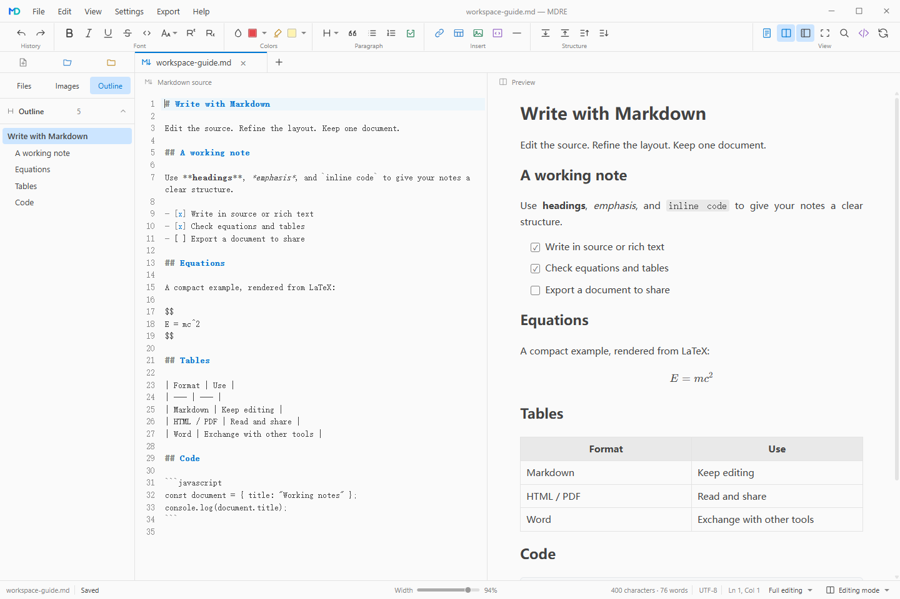

<p align="center"></p>

<h1 align="center">MDRE</h1>

<p align="center"><strong>同一份 Markdown，两种编辑方式。</strong><br>面向 Windows 的 Markdown 编辑、排版与阅读工作区。<br><sub>Windows 10 / 11 · x64 · English / 简体中文</sub></p>

<p align="center">
  <a href="https://github.com/LaizhuangJi0601/MDRE/blob/main/CHANGELOG.md"></a>
  <a href="LICENSE"></a>
  <a href="https://developer.microsoft.com/microsoft-edge/webview2/"></a>
</p>

<p align="center"><a href="#功能">功能</a> · <a href="#下载安装">下载安装</a> · <a href="#开发">开发</a> · <a href="#参与贡献">参与贡献</a> · <a href="#许可">许可</a></p>

<p align="center"><a href="README.md">English</a> · <strong>简体中文</strong></p>

## 界面预览



## 功能

- **源码与富文本同步编辑。** 两栏保持同步，也可仅显示富文本；标题、列表、链接和文字格式可通过工具栏或右键菜单编辑。
- **公式、图表与代码。** KaTeX 呈现数学公式，MathLive 提供可视化公式编辑；支持 Mermaid 图表、代码高亮与代码块主题。
- **按阅读方式排版。** A4 连续或分页视图支持 25%–250% 缩放；非 A4 页宽可在 60%–100% 间调整，正文支持四种对齐方式。
- **处理表格与图片。** 调整列宽、对齐、合并和拆分单元格；图片管理按引用顺序列出资源，并可定位到正文。
- **导出与互通。** 导出 HTML、PDF，或包含 Markdown 与本地图片的 ZIP；支持复制为富文本及 HTML 转 Markdown 粘贴。
- **Word 转换。** 调用另行安装的 Pandoc 导入、导出 `.docx`，支持常见结构与公式。
- **按偏好组织工作区。** 提供浅色／深色主题、简体中文／English、视图预设、分类设置、章节导航和可搜索的离线帮助。

文件侧栏、标签和最近项目集中在工作区内；支持自动保存、恢复快照、外部文件变更检测及阅读位置恢复。

编辑与预览在本机运行；编辑器资源、公式字体与帮助文档随程序提供。网络图片与外部链接的可用性取决于网络。支持范围见[使用指南](docs/help/MDRE使用.md)与[语法参考](docs/help/MDRE语法.md)。

## 下载安装

当前构建为 **0.2.6 · updata2**。[更新记录](CHANGELOG.md)汇总版本变化。

| 版本 | 下载 | 运行要求 |
| --- | --- | --- |
| Windows 桌面版 | [下载 mdre.exe](https://github.com/LaizhuangJi0601/MDRE/raw/refs/heads/main/mdre.exe) · [SHA-256](SHA256SUMS.txt) | Windows 10 / 11 · x64 |

下载后运行 `mdre.exe`。Windows 需要安装 [Microsoft Edge WebView2 Runtime](https://developer.microsoft.com/microsoft-edge/webview2/)。首次打开后，可通过欢迎页新建文档或打开现有 Markdown 文件。

偏好设置、图片资源与恢复数据保存在用户的应用数据目录中。支持在设置中选择语言、主题、默认视图和快捷键。

Word 转换为可选功能。先安装 [Pandoc](https://pandoc.org/installing.html)，再在“设置 → Word 转换”中自动检测，或指定可执行文件的完整路径。Windows 必须具体到 `pandoc.exe`，不能只填目录。复杂 Word 版式可能简化，重要文档应核对转换结果。

另一种使用方式：[VS Code 插件](https://github.com/LaizhuangJi0601/MDRE-for-VS-Code)。

## 开发

在 Windows 10／11 x64 上构建。需要 Node.js 24 LTS、pnpm 12.x、Rust stable 的 MSVC 工具链，以及包含 C++ 桌面开发与 Windows SDK 的 Visual Studio Build Tools；详见 [Tauri 编译前提](https://v2.tauri.app/start/prerequisites/#windows)。

```powershell
git clone https://github.com/LaizhuangJi0601/MDRE.git
cd MDRE
pnpm install --frozen-lockfile
pnpm app:build
```

构建完成后运行 `src-tauri/target/release/mdre.exe`。`pnpm dev` 启动前端开发服务，`pnpm app` 启动桌面开发实例。

## 参与贡献

欢迎通过 [Issues](https://github.com/LaizhuangJi0601/MDRE/issues) 报告问题或提出建议，也可提交 Pull Request。报告问题时，请附上版本、操作步骤和最小 Markdown 示例；界面问题可附截图。涉及文档的改动，请同步维护中英文说明。

## 许可

MDRE 采用 [MIT 许可证](LICENSE)。感谢 [Tauri](https://tauri.app/)、[CodeMirror](https://codemirror.net/)、[ProseMirror](https://prosemirror.net/)、[markdown-it](https://github.com/markdown-it/markdown-it)、[KaTeX](https://katex.org/)、[MathLive](https://mathlive.io/)、[Mermaid](https://mermaid.js.org/) 与 [highlight.js](https://highlightjs.org/) 等开源项目。

第三方组件的版权与使用条件以原始许可证为准，见[声明与许可](docs/help/MDRE声明.md)。
